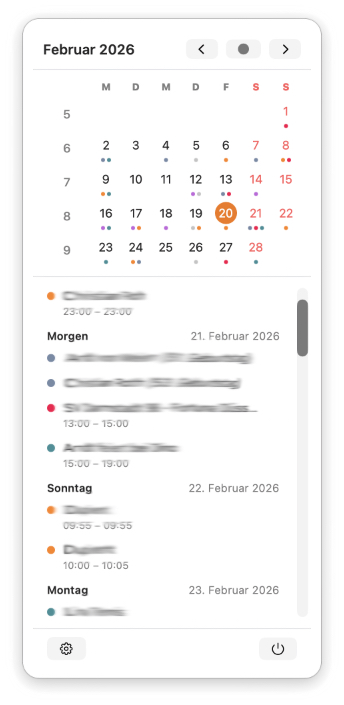

# MenuBarCalendar

MenuBarCalendar is a lightweight macOS menu bar app that puts a full month calendar and your upcoming Calendar.app events one click away. It reads your existing Apple Calendar accounts, highlights today and weekends, shows a colour dot per calendar for each day with events, and lists upcoming events and reminders with automatic scrolling to the current or next entry. Tapping an event opens it directly in Apple Calendar.


---

## Screenshots



---

## Features

- 📅 **Month calendar grid** — week starts on Monday, with ISO week numbers
- 🎯 **Today highlighted** with accent colour; selected day with outline
- 🔴 **Weekend dates** in red
- 🟢 **Event dots** per calendar colour (up to 3 per day)
- 📋 **Upcoming events list** — scrolls to current or next event automatically; multi-day events appear on every day
- 🗓 **Opens Apple Calendar** on event tap
- ✅ **Reminders** with due dates — tick them off right in the list, tap to open in Reminders
- ⏱ **Next event in the menu bar** (optional), updated every minute
- 🔄 **Live updates** — changes from Calendar, Reminders or iCloud appear immediately
- ⬆️ **Update hint** — shows when a newer version is available
- ⚙️ **Settings** — select which calendars and reminder lists to show, toggle launch at login
- 🌍 **Localised** — English and German (follows system language)
- 🌙 **Midnight refresh** — icon and selected date always show today
- 🚀 **Launch at Login** support via `SMAppService`
- 🔒 No dock icon (`LSUIElement` / `NSApp.setActivationPolicy(.accessory)`)

---

## Requirements

| | |
|---|---|
| macOS | 26 Tahoe or later |
| Architecture | Apple Silicon only |
| Xcode | 26 or later |
| Swift | 5.9 or later |

---

## Installation

### Build from source

1. Clone the repository:
   ```bash
   git clone https://github.com/dirkclemens/MenuBarCalendar.git
   cd MenuBarCalendar
   ```
2. Open `MenuBarCalendar.xcodeproj` in Xcode.
3. Select the `MenuBarCalendar` scheme and your Mac as the target.
4. Build and run (`⌘R`).

### Calendar permission

On first launch macOS will ask for **Calendar** and **Reminders** access. You can also grant it manually in:

> System Settings → Privacy & Security → Calendars / Reminders → MenuBarCalendar ✓

### Prebuilt DMG

A ready-to-run build is available as `MenuBarCalendar.dmg` (ad-hoc signed, Apple Silicon only). Since it isn't notarized by Apple, macOS blocks it on first launch. Remove the quarantine flag before opening:

```bash
xattr -dr com.apple.quarantine /Applications/MenuBarCalendar.app
```

Alternatively, right-click the app in Finder and choose "Open".

---

## Project Structure

```
MenuBarCalendar/
├── AppDelegate.swift                    # App lifecycle, timers, day/time-zone changes, launch at login
├── AppEnvironment.swift                 # Detects unit-test runs
├── CalendarManager.swift                # EventKit access, event/reminder fetching, calendar state
├── Formatters.swift                     # Shared, cached date formatters
├── MenuBarCalendar.swift                # @main App entry point, MenuBarExtra
├── UpdateChecker.swift                  # Daily "newer version available" check
├── Views/
│   ├── ContentView.swift                # Popover root (calendar / settings pages, footer)
│   ├── CalendarView.swift               # Root view
│   ├── CalendarNavigationView.swift     # Month header + prev/today/next buttons
│   ├── CalendarGridView.swift           # Week grid with day cells
│   ├── DayCellView.swift                # Individual day cell
│   ├── WeekNumberView.swift             # ISO week number column
│   ├── EventDotsView.swift              # Coloured event dot indicators
│   ├── ReminderDotsView.swift           # Outlined reminder dot indicators
│   ├── EventsListView.swift             # Scrollable upcoming events list
│   ├── DaySectionView.swift             # Day group header + event and reminder rows
│   ├── EventRowView.swift               # Single event row with time
│   ├── ReminderRowView.swift            # Single reminder row (complete / open in Reminders)
│   ├── NoAccessView.swift               # Shown when calendar access is denied
│   ├── EmptyEventsView.swift            # Shown when no upcoming events
│   └── UpdateBadgeView.swift            # Footer hint for a newer version
├── Settings/
│   ├── SettingsView.swift               # Settings form
│   ├── CalendarsListView.swift          # Grouped calendar list
│   ├── CalendarSelectionView.swift      # Single calendar toggle row
│   ├── ReminderListsView.swift          # Reminder list toggles
│   └── SettingsRowView.swift            # Generic settings row with icon + chevron
├── en.lproj/Localizable.strings
└── de.lproj/Localizable.strings
MenuBarCalendarTests/
└── MenuBarCalendarTests.swift           # Unit tests (Swift Testing)
```

## Tests

Run the unit tests in Xcode with `⌘U`, or from the command line:

```bash
xcodebuild test -project MenuBarCalendar.xcodeproj -scheme MenuBarCalendar -destination 'platform=macOS'
```

They cover the day index (multi-day and overnight events), the month grid and ISO week numbers, reminder due dates, the migration of the calendar selection and the update check. No calendar permission is needed.

## Localisation

The app ships with **English** and **German**. To add another language:

1. Add the language in Xcode → Project → Info → Localizations.
2. Duplicate `en.lproj/Localizable.strings` into the new `xx.lproj/` folder.
3. Translate the values.

## Privacy

MenuBarCalendar reads your calendars and reminders via EventKit. It only writes when you tick off a reminder (marks it as completed). Calendar and reminder data never leave your device.

At launch and then once a day the app asks `https://api.adcore.de/apps/check.php` whether a newer version exists. This request contains only the app name, app version, macOS version and CPU architecture — no personal or calendar data.

## Credits

Inspired by [itsybitsycal](https://github.com/harryfliu/itsybitsycal) by [@harryfliu](https://github.com/harryfliu).

---

## License

This project is licensed under the [PolyForm Noncommercial License 1.0.0](https://polyformproject.org/licenses/noncommercial/1.0.0) — see [LICENSE](LICENSE) for details. Free for noncommercial use; commercial use requires a separate license from the author.
